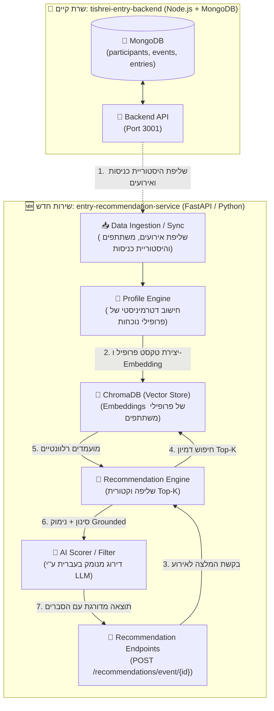

# 🏗️ תוכנית על (Master Plan): שירות המלצות משתתפים לאירועים (`entry-recommendation-service`)

> תוכנית לפרויקט גמר המיישמת את עקרונות הקורס (The 6-Step Loop, Vertical Slices, Vector Search, ChromaDB, AI Scoring, Grounded Generation, ואבטחה).
> **הערה מרכזית:** המערכת אינה מקימה מחדש DB של משתמשים/אירועים/סריקות – כל הנתונים הבסיסיים מנוהלים כבר ב-`tishrei-entry-backend` (MongoDB).

---

## 📐 ארכיטקטורת המערכת והשילוב עם הקיים



---

## 🗺️ מיפוי מושגי הקורס למערכת החדשה

| מושג מהקורס | מודול | איך מיושם בפרויקט |
|---|---|---|
| **The 6-Step Loop** | Module 02 | כל שלב מבוצע לפי: Frame → Plan → Prompt → Execute → Verify → Reflect |
| **Vertical Slices** | Module 02 | חלוקה ל-Slices עצמאיים ברי בדיקה |
| **Pydantic + FastAPI + DI** | Module 02, 05 | חוזי נתונים מדויקים, שימוש ב-`Depends()` והפרדת תלויות |
| **Deterministic Profiling** | Module 02 | חישוב תפלגות זמנים, שעות מועדפות ואחוזי נוכחות ללא הזיות LLM |
| **Embeddings & ChromaDB (HNSW)** | AIE 02 | אינדוקס פרופילי משתתפים בעזרת Sentence-Transformers |
| **Hybrid Search (Dense + BM25)** | AIE 02 | התאמה בין מאפייני אירוע (תיאור, שעה, קהל יעד) לפרופיל המשתתף |
| **Grounded Generation (PCTCO)** | AIE 01, 02 | פרומפט מוקפד שמחייב את ה-LLM להסביר על בסיס הנתונים בלבד |
| **Rule-as-a-Test & Security** | Module 05 | בדיקות הרשאות (JWT של ה-Backend הקיים), ומניעת חריגות וציונים לא תקינים |

---

## 📁 מבנה הקבצים בשירות החדש

```text
entry-recommendation-service/
├── plans/                                # 📋 תוכניות עבודה
│   ├── PLAN.md                           # ← תוכנית העל הראשית (קובץ זה)
│   ├── slice-1-data-contract.md          # תוכנית מפורטת ל-Slice 1
│   ├── slice-2-profile-engine.md         # תוכנית מפורטת ל-Slice 2
│   ├── slice-3-vector-store.md           # תוכנית מפורטת ל-Slice 3
│   ├── slice-4-ai-scorer.md              # תוכנית מפורטת ל-Slice 4
│   ├── slice-5-recommendation-api.md     # תוכנית מפורטת ל-Slice 5
│   └── slice-6-security-e2e.md           # תוכנית מפורטת ל-Slice 6
│
├── app/
│   ├── __init__.py
│   ├── main.py                           # אפליקציית FastAPI
│   ├── config.py                         # הגדרות (Pydantic BaseSettings)
│   ├── clients/                          # ממשק מול השרת הקיים (MongoDB / Backend API)
│   │   ├── __init__.py
│   │   └── backend_client.py             # שליפת participants, events, entries
│   ├── profiles/                         # מנוע חישוב הפרופילים
│   │   ├── __init__.py
│   │   ├── models.py                     # מודלי Pydantic לפרופיל
│   │   └── engine.py                     # ProfileEngine - חישוב דטרמיניסטי והמרת פרופיל לטקסט
│   ├── recommendations/                  # מנוע ההמלצות
│   │   ├── __init__.py
│   │   ├── models.py                     # RecommendationRequest/Response
│   │   ├── vector_store.py               # VectorStorePort + ChromaDBAdapter
│   │   ├── ai_scorer.py                  # AIScorerPort + LLMScorer
│   │   ├── prompts.py                    # תבניות פרומפט Grounded
│   │   └── service.py                    # RecommendationService (Orchestrator)
│   └── routers/
│       ├── __init__.py
│       ├── health.py                     # בדיקת תקינות
│       └── recommendations.py            # Endpoints של ההמלצות
│
├── tests/                                # בדיקות אוטומטיות (pytest)
│   ├── conftest.py                       # Fixtures ו-Mocks
│   ├── test_profile_engine.py
│   ├── test_vector_store.py
│   ├── test_ai_scorer.py
│   └── test_recommendation_flow.py
│
├── requirements.txt                      # תלויות פייתון
└── .env.example                          # משתני סביבה לדוגמה
```

---

## 🔪 תוכנית ה-Vertical Slices (סדר הפיתוח)

> **הערה מתודית:** בכל שלב, לפני שכותבים קוד, מייצרים את ה-plan הספציפי שלו מתוך ההנחיות כאן (לדוגמה `slice-1-data-contract.md`), מריצים את הלופ, בודקים ומתקדמים.

---

### 🔹 Slice 1: מודלים וסנכרון נתונים מול ה-Backend הקיים
- **Frame:** הגדרת מודלי הנתונים (Pydantic) עבור המשתתפים, האירועים והכניסות כפי שהם קיימים ב-Node.js (`Participant`, `Event`, `Entry`).
- **בנייה:** בניית `backend_client.py` שמתחבר ל-MongoDB הקיים (או מול ה-REST API של ה-Backend) לקריאת נתונים בלבד.
- **Verify:** טסט שמוודא משיכה ומיפוי תקין של משתתפים וכניסות לתוך מודלי Pydantic.

---

### 🔹 Slice 2: Profile Engine (חישוב התנהגותי דטרמיניסטי)
- **Frame:** חישוב תכונות התנהגותיות של כל משתתף על בסיס היסטוריית הכניסות (ללא AI):
  - פילוח זמנים מועדפים (בוקר / צהריים / ערב).
  - אחוז נוכחות כולל.
  - סוגי אירועים מועדפים (לפי תיאור/שם האירוע).
  - פונקציית `profile_to_text()` שממירה את הפרופיל לפסקה תיאורית עשירה לצורך Embedding.
- **Verify:** בדיקות Unit מלאות על חישובי האחוזים, גבולות השעות והמרת הטקסט.

---

### 🔹 Slice 3: Vector Store (אינדוקס וחיפוש ב-ChromaDB)
- **Frame:** הקמת מתאם ChromaDB ואחסון ה-Embeddings של המשתתפים.
- **בנייה:**
  - שימוש ב-Sentence-Transformers ליצירת וקטורים.
  - שמירת metadata (עיר, קבוצה, אחוזי נוכחות).
  - חיפוש דמיון קוסינוס (Cosine Similarity) לפי תיאור אירוע חדש.
- **Verify:** בדיקות אינטגרציה: הוספת 5 פרופילים שונים, חיפוש אירוע ואימות שהמועמד הרלוונטי עולה בראש התוצאות (Top-K).

---

### 🔹 Slice 4: AI Scorer & Grounded Prompts
- **Frame:** שכבת ה-LLM שמקבלת את האירוע ואת המועמדים מ-ChromaDB, ומבצעת דירוג סופי עם נימוק.
- **בנייה:**
  - פרומפט Grounded לפי עקרונות PCTCO (הסבר אך ורק על סמך נתוני הפרופיל).
  - קבלת ציון 0-100 והסבר בעברית.
  - תמיכה ב-Mock Scorer לצורך טסטים מהירים וחסכוניים.
- **Verify:** טסטים מול Mock LLM: ולידציית טווח ציונים (0-100), מבנה JSON תקין, והתמודדות עם היעדר נתונים.

---

### 🔹 Slice 5: שירות ההמלצות המלא ו-FastAPI Endpoints
- **Frame:** הרכבת הצינור המלא (`RecommendationService`):
  1. קבלת `eventId`.
  2. שליפת פרטי האירוע.
  3. שליפת מועמדים מ-ChromaDB.
  4. שליחה ל-AI Scorer.
  5. החזרת רשימה מדורגת עם נימוקים.
- **Verify:** בדיקת E2E של ה-endpoint: `POST /api/recommendations/events/{eventId}`.

---

### 🔹 Slice 6: אבטחה, Rule-as-a-Test ובדיקות מערכת
- **Frame:** נעילת השירות באבטחה מותאמת.
- **בנייה:**
  - אימות טוקן JWT מול ה-`JWT_SECRET` המשותף של שרת ה-Backend.
  - בדיקת הרשאות (רק משתמשים מורשים יכולים לבקש המלצות).
  - ולידציות קלט למניעת הזרקות ושיבושים.
- **Verify:** הרצת כל חבילת הבדיקות (`pytest`), בדיקת כיסוי ואימות פעולה חלקה.

---

## 📌 איך ממשיכים מכאן?
בכל שלב שתרצה להתחיל לפתח:
1. נפנה ל-Slice הרלוונטי מהתוכנית הזו.
2. נייצר קובץ plan מפורט (למשל `plans/slice-1-data-contract.md`).
3. נממש, נריץ טסטים, ונוודא הצלחה לפני המעבר לשלב הבא!
