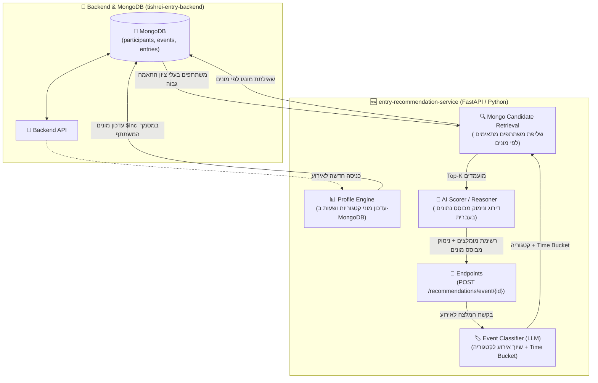

# 🏗️ תוכנית על (Master Plan): שירות המלצות משתתפים לאירועים (`entry-recommendation-service`)

> תוכנית מעודכנת המבוססת על **פרופילי התנהגות מבוססי מונים (Feature & Buckets Counters)** ב-MongoDB, סיווג אירועים ע"י LLM, שליפה יעילה ודירוג/נימוק מותאם – ללא צורך ב-Vector DB (כמו ChromaDB) או Embeddings כבדים.
> **הערה מרכזית:** הנתונים מנוהלים ב-`tishrei-entry-backend` (MongoDB). שירות ההמלצות מעדכן ומשתמש במוני הפעילות במסמכי המשתתפים.

---

## 💡 תפיסת הארכיטקטורה החדשה (Feature Counters)

1. **סיווג אירועים חכם (LLM Event Categorization):**
   * לכל אירוע (למשל: "טורניר קט-רגל ישיבתי") מופעל LLM שמחלץ קטגוריה ברורה (למשל `sports_football`, `shiur_torah`, `farbrengen`).
   * בנוסף, מועד האירוע ממופה ל-**Time Bucket** (חלוקת היממה ל-N מקטעים קבועים, למשל בוקר, צהריים, ערב, לילה).
2. **עדכון מונים במסמך המשתתף (Participant Behavioral Counters):**
   * עם כל כניסה (Scan/Entry) של משתתף לאירוע, מתעדכן הפרופיל שלו ב-MongoDB:
     * מונה לקטגוריה הספציפית (`stats.categories.<category> += 1`).
     * מונה למקטע הזמן ביום (`stats.time_buckets.<bucket_id> += 1`).
     * סך כל ההשתתפויות (`stats.total_attendances += 1`).
3. **שליפת מועמדים ישירה מ-MongoDB (Filtering & Scoring):**
   * כאשר מבקשים המלצות לאירוע חדש:
     * ה-LLM מסווג את האירוע החדש לקטגוריה ולמקטע זמן.
     * מריצים שאילתת MongoDB (Aggregation / Query) שמחפשת משתתפים עם התאמה גבוהה (ציון מבוסס מוני קטגוריה + מוני שעות).
4. **דירוג ונימוק סופי (Grounded AI Scorer):**
   * המועמדים המובילים (Top-K) מועברים ל-LLM קל עם הנתונים המדויקים ("השתתף 8 פעמים בכדורגל, 10 פעמים בשעות הערב").
   * ה-LLM מייצר הסבר מנומק בעברית מדוע המשתתף מתאים לאירוע זה.

---

## 📐 תרשים זרימה (Flowchart)



---

## 📊 מבנה הנתונים המוצע (Schema ב-MongoDB)

במסמך של כל `participant`:
```json
{
  "_id": "participant_obj_id",
  "name": "ישראל ישראלי",
  "email": "israel@example.com",
  "stats": {
    "categories": {
      "sports_football": 8,
      "shiur": 2,
      "social": 5
    },
    "time_buckets": {
      "slot_morning_06_12": 1,
      "slot_afternoon_12_17": 3,
      "slot_evening_17_21": 10,
      "slot_night_21_06": 4
    },
    "days_of_week": {
      "sunday": 3,
      "monday": 1,
      "tuesday": 2,
      "wednesday": 0,
      "thursday": 8,
      "friday": 1,
      "saturday": 0
    },
    "punctuality": {
      "on_time": 11,
      "late": 4
    },
    "streak": {
      "current_streak": 3,
      "longest_streak": 5
    },
    "total_attendances": 15,
    "last_active": "2026-11-20T19:30:00Z"
  }
}
```

---

## 📁 מבנה הקבצים המעודכן

```text
entry-recommendation-service/
├── plans/                                # 📋 תוכניות עבודה
│   ├── plan.md                           # ← תוכנית העל הראשית (קובץ זה)
│   ├── slice-1-data-contract.md          # מודלים, חיבור ל-DB ו-Time Buckets
│   ├── slice-2-event-classifier.md       # סיווג אירועים ע"י LLM
│   ├── slice-3-profile-counters.md       # ניהול ועדכון מונים במסמך המשתתף
│   ├── slice-4-mongo-retrieval.md        # שאילתות שליפת מועמדים לפי מונים
│   ├── slice-5-ai-scorer.md              # דירוג ונימוק מבוסס Grounded Data
│   └── slice-6-recommendation-api.md     # API מלא, אבטחה ובדיקות E2E
│
├── app/
│   ├── __init__.py
│   ├── main.py                           # אפליקציית FastAPI
│   ├── config.py                         # הגדרות (Settings)
│   ├── database.py                       # חיבור ל-MongoDB (Motor / PyMongo)
│   ├── classification/                   # סיווג אירועים וחלוקת זמנים
│   │   ├── __init__.py
│   │   ├── time_buckets.py               # מיפוי שעה למקטע זמן ביום
│   │   └── classifier.py                 # LLM Event Categorizer
│   ├── profiles/                         # ניהול פרופיל מונים
│   │   ├── __init__.py
│   │   ├── models.py                     # מודלי Pydantic לפרופיל ולסטטיסטיקות
│   │   └── engine.py                     # עדכון מונים ב-DB ($inc)
│   ├── recommendations/                  # מנוע ההמלצות
│   │   ├── __init__.py
│   │   ├── models.py                     # RecommendationRequest / Response
│   │   ├── mongo_retrieval.py            # שאילתות מונגו לשליפת מועמדים
│   │   ├── ai_scorer.py                  # LLM Scorer & Reasoner
│   │   ├── prompts.py                    # תבניות פרומפט
│   │   └── service.py                    # RecommendationService (Orchestrator)
│   └── routers/
│       ├── __init__.py
│       ├── health.py
│       └── recommendations.py
│
├── tests/
│   ├── conftest.py
│   ├── test_time_buckets.py
│   ├── test_event_classifier.py
│   ├── test_profile_counters.py
│   ├── test_mongo_retrieval.py
│   ├── test_ai_scorer.py
│   └── test_recommendation_flow.py
│
├── requirements.txt
└── .env.example
```

---

## 🔄 פרוטוקול עבודה מחייב לכל שלב (Slice Workflow Protocol)

בכל מעבר לפיתוח שלב (Slice) חדש, נפעל לפי הנוהל המובנה הבא:
1. **הצעת תוכנית בעברית:** הסוכן יציג הצעה מפורטת למימוש השלב (מטרות, רכיבים, קבצים ובדיקות).
2. **דיון ודיוק משותף:** נדון על ההצעה, נשנה, נוסיף או נדייק דרישות בהתאם למשוב שלך.
3. **יצירת קובץ Plan רשמי באנגלית:** רק לאחר אישורך המלא, נייצר/נעדכן את קובץ התוכנית הייעודי באנגלית (לדוגמה `plans/slice-1-data-contract.md`), ונפעל לפיו למימוש הקוד והבדיקות.

---

## 🔪 תוכנית ה-Vertical Slices (שלבי הפיתוח)

### 🔹 Slice 1: חוזי נתונים (Data Contracts) ומנגנון Time Buckets
- **Frame:** הגדרת מודלי Pydantic למשתתפים, מונים, אירועים וסריקות.
- **בנייה:**
  - פונקציה דטרמיניסטית `get_time_bucket(dt)` המחלקת את שעות היממה למקטעים (למשל: בוקר, צהריים, אחה"צ, ערב, לילה).
  - חיבור נקי ל-MongoDB באמצעות Motor / PyMongo.
- **Verify:** בדיקות יחידה על חישוב ה-buckets לפי שעות ותאריכים שונים.

---

### 🔹 Slice 2: סיווג אירועים ע"י LLM (Event Classifier)
- **Frame:** יצירת מודול שמקבל שם אירוע ותיאור, ומסווג אותו לקטגוריה סטנדרטית (למשל: ספורט/כדורגל, שיעור תורה, פעילות חברתית, התוועדות).
- **בנייה:**
  - פרומפט מוגדר עם רשימת קטגוריות יעד קבועות (Enum / Taxonomies) ותמיכה בהרחבה.
  - מימוש מנגנון Caching (כדי לא לסווג מחדש את אותו האירוע).
  - תמיכה ב-Mock Classifier לטסטים ללא עלות API.
- **Verify:** בדיקות עם אירועים מגוונים ובדיקת עמידות מול שמות קצרים או תיאורים חסרים.

---

### 🔹 Slice 3: ניהול ועדכון מוני הפרופיל (Profile Counters Engine)
- **Frame:** לוגיקה לעדכון מוני המשתתף ב-MongoDB בעת רישום נוכחות באירוע.
- **בנייה:**
  - עדכון יעיל במונגו באמצעות `$inc` אטומי:
    - הגדלת המונה לקטגוריית האירוע ב-1.
    - הגדלת המונה ל-time bucket של מועד האירוע ב-1.
    - הגדלת `total_attendances` ב-1 ועדכון `last_active`.
  - פונקציית backfill / replay שתאפשר לחשב מונים רטרואקטיבית על כל היסטוריית ה-entries הקיימת.
- **Verify:** בדיקות אינטגרציה: סריקת 3 אירועים ובדיקה שמסמך המשתתף ב-DB התעדכן במונים הנכונים.

---

### 🔹 Slice 4: שליפת מועמדים מ-MongoDB (Candidate Retrieval)
- **Frame:** שאילתת מונגו חכמה ויעילה שמוצאת את המשתתפים המתאימים ביותר לאירוע ספציפי.
- **בנייה:**
  - חישוב ציון התאמה משוקלל:
    `Score = (Category_Counter * W_cat) + (Time_Bucket_Counter * W_time) + Recency_Bonus`
  - שאילתת Mongo Aggregation שמחזירה את ה-Top K משתתפים (למשל 20 מועמדים).
- **Verify:** בדיקת שאילתה מול מסד נתונים עם מספר משתתפים שונים, ווידוא שהמשתתף עם הנתונים המתאימים ביותר מופיע ראשון.

---

### 🔹 Slice 5: דירוג ונימוק סופי (AI Scorer & Reasoner)
- **Frame:** שכבת ה-LLM שמקבלת את הנתונים העובדתיים של המועמדים ומייצרת הסבר אנושי ומשכנע בעברית.
- **בנייה:**
  - פרומפט Grounded המקבל את נתוני האירוע ואת המונים של המשתתף ("המשתתף נכח ב-8 אירועי כדורגל ופעיל בעיקר בשעות הערב").
  - החזרת ציון מותאם והסבר ברור בעברית מדוע המשתתף מומלץ לאירוע זה.
- **Verify:** בדיקות ולידציה של הפלט, וידוא שאין הזיות (ההסבר נשען ישירות על המונים שהוזנו).

---

### 🔹 Slice 6: API מלא, אבטחה ובדיקות E2E
- **Frame:** חיבור כל הרכיבים ל-Endpoint של FastAPI (`POST /recommendations/event/{id}`).
- **בנייה:**
  - שילוב ה-Flow המלא: סיווג אירוע -> שליפת מועמדים ממונגו -> דירוג ונימוק ע"י LLM -> החזרת תשובה.
  - אימות הרשאות ואבטחה (JWT Secret תואם ל-Backend הקיים).
- **Verify:** בדיקת קצה-לקצה (E2E) של תהליך הבקשה והתשובה.
